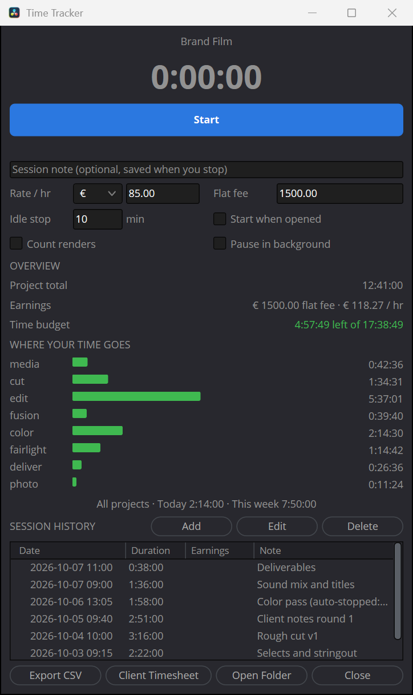
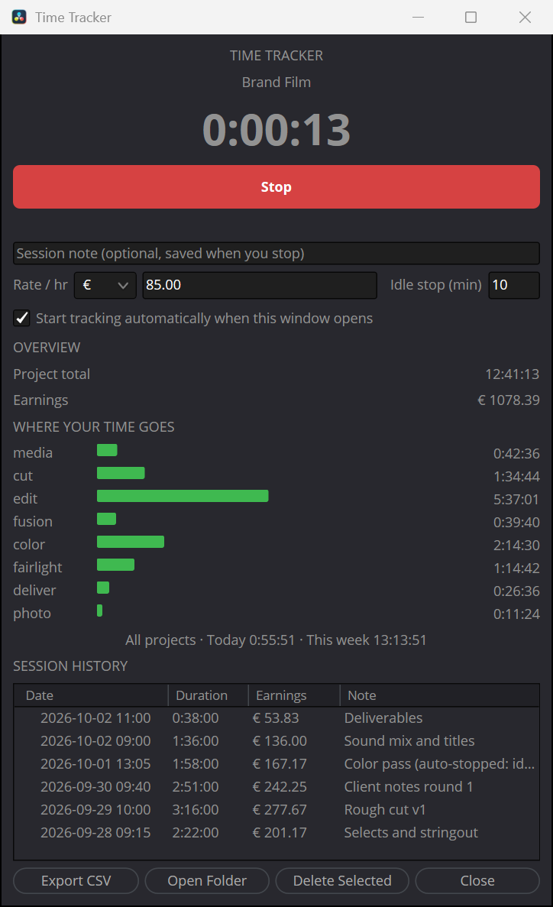

# Time Tracker for DaVinci Resolve

A free, open-source time tracker that lives inside DaVinci Resolve's
**Workspace > Scripts** menu. One Lua file: no plugins, no Python, no accounts,
nothing to sign up for. Your data stays on your computer.

It knows which project is open, which page you're working on, and when you've
walked away from the keyboard, so your timesheet reflects real work instead of a
guess. When the job is done, one click exports an invoice-ready spreadsheet.

<p align="center">
  
  &nbsp;&nbsp;
  
</p>

## Features

- **Automatic project tracking.** Picks up the open project and keeps separate
  totals per project. Switching projects mid-session splits the session.
- **Time per page.** Bars show how your time splits across Media, Cut, Edit,
  Fusion, Color, Fairlight, Deliver and Photo. Useful for quoting the next job.
- **Idle detection with rewind.** Watches real mouse and keyboard input. If you
  step away longer than your idle limit (default 10 minutes), the session is
  closed at your *last real input*, so coffee breaks never land on the invoice.
  Tracking resumes on its own when you're back.
- **Opens with Resolve (optional, Windows).** The tracker can pop up on its own
  whenever you open a project. Tick **Start tracking automatically** too and
  there's nothing left to remember.
- **Rates and earnings.** Hourly rate plus currency. Each session keeps the rate
  it was tracked at, so changing your rate mid-project bills every hour
  correctly. Different currencies are totalled separately, never converted.
- **Invoice-ready CSV export.** Exports every project at once, grouped by
  project with each day's sessions stacked underneath, a subtotal per project,
  and a grand total. Per-page time columns at every level. Opens correctly in
  Excel, Numbers, LibreOffice and Google Sheets.
- **Crash-safe.** The running session is saved every second. If Resolve
  crashes, the session is recovered the next time you open the tracker.
- **Safe history.** Saves never overwrite good data with a half-written file,
  and deleting a session takes a confirming second click.
- **One window only.** Opening the script again brings the existing window to
  the front instead of starting a second tracker that would double-count.

## Installation

You only need one file: **`Time Tracker.lua`**.

1. Download the zip from the
   [latest release](https://github.com/visavv/resolve-time-tracker/releases/latest)
   (or click **Code > Download ZIP** on this page) and extract it.
2. Install it with **one** of the options below.
3. Restart DaVinci Resolve.
4. Open it from **Workspace > Scripts > Time Tracker**.

### Windows, option A: installer script

Right-click **`install.ps1`** and choose **Run with PowerShell**. It copies the
script into your Resolve scripts folder and asks whether the tracker should open
automatically with Resolve (see [Open it automatically](#open-it-automatically-with-resolve-windows)).

If Windows says running scripts is disabled, open PowerShell in the extracted
folder and run:

```powershell
powershell -ExecutionPolicy Bypass -File .\install.ps1
```

### Windows, option B: drag and drop

1. Press **Win + R**, paste the path below and press **Enter**:

   ```
   %APPDATA%\Blackmagic Design\DaVinci Resolve\Support\Fusion\Scripts
   ```

2. If there is no **`Utility`** folder inside, create one (right-click >
   **New > Folder**, name it `Utility`).
3. Drag **`Time Tracker.lua`** into the `Utility` folder.

### macOS: drag and drop

1. In Finder, choose **Go > Go to Folder...** (Shift + Cmd + G), paste the path
   below and press **Return**:

   ```
   ~/Library/Application Support/Blackmagic Design/DaVinci Resolve/Fusion/Scripts
   ```

2. If there is no **`Utility`** folder inside, create one (**File > New
   Folder**, name it `Utility`).
3. Drag **`Time Tracker.lua`** into the `Utility` folder.

### Linux

Copy the file into your user scripts folder:

```bash
mkdir -p ~/.local/share/DaVinciResolve/Fusion/Scripts/Utility
cp "Time Tracker.lua" ~/.local/share/DaVinciResolve/Fusion/Scripts/Utility/
```

### Install for every user on the computer (optional)

Use the shared folder instead of your personal one:

| OS | Folder |
|---|---|
| Windows | `%PROGRAMDATA%\Blackmagic Design\DaVinci Resolve\Fusion\Scripts\Utility` |
| macOS | `/Library/Application Support/Blackmagic Design/DaVinci Resolve/Fusion/Scripts/Utility` |
| Linux | `/opt/resolve/Fusion/Scripts/Utility` |

### Open it automatically with Resolve (Windows)

Resolve has no setting to run a script at startup, so the installer can add a
tiny helper to your Windows Startup folder. It waits in the background and, as
soon as Resolve opens a project, opens the tracker exactly as the Scripts menu
would. If you close the tracker, it stays closed until you restart Resolve.

```powershell
powershell -ExecutionPolicy Bypass -File .\install.ps1 -Autostart
```

Turn it off again with `-RemoveAutostart` (the tracker itself stays installed).

It needs **DaVinci Resolve Studio** with **Preferences > System > General >
External scripting using** set to **Local**. Be aware that this Resolve setting
lets any program running on your computer control Resolve through its scripting
API (never other computers; that would be the *Network* option). Leave it off if
you don't want that; the tracker still works from the Scripts menu without it.
If the tracker doesn't appear, the
helper's log at `%LOCALAPPDATA%\ResolveTimeTracker\autostart.log` says why. The
helper shows up as *Time Tracker for DaVinci Resolve* in Task Manager's Startup
apps.

To have tracking start the moment the window appears, also tick **Start tracking
automatically when this window opens** in the tracker.

### Updating and uninstalling

- **Update:** close the tracker window, replace `Time Tracker.lua` (or rerun
  `install.ps1`), then reopen it. Your tracked time is kept.
- **Uninstall:** run `install.ps1 -RemoveAutostart` if you turned auto-open on,
  then delete `Time Tracker.lua` from the `Utility` folder. Your tracked time
  stays in the data folder (see below) until you delete that too.

## Using it

1. Open a project, then **Workspace > Scripts > Time Tracker**.
2. Set your hourly rate, currency and idle limit once. They're remembered.
3. Press **Start** (blue). The button turns red while tracking; press **Stop**
   when you're done. Add an optional note first and it's saved with the session.
4. Leave the window open while you work. It can sit behind Resolve; opening the
   script again brings it back to the front.
5. Press **Export CSV** for a spreadsheet, and **Open Folder** to find it.

Set **Idle stop** to `0` to turn idle detection off.

### What the export looks like

```text
Project,Date,Start,End,Duration,Hours,Rate,Currency,Earnings,Note,Media Time,Cut Time,Edit Time,...
Brand Film,2026-09-28,09:15,11:37,2:22:00,2.3667,85.00,€,201.17,Selects and stringout,0:42:36,1:11:00,0:28:24,...
Brand Film,2026-09-29,10:00,13:16,3:16:00,3.2667,85.00,€,277.67,Rough cut v1,,0:23:31,2:36:49,...
Brand Film,2026-10-01,13:05,15:03,1:58:00,1.9667,85.00,€,167.17,Color pass (auto-stopped: idle),,,0:17:42,...
Brand Film (subtotal),,,,12:41:00,12.6833,,€,1078.08,,0:42:36,1:34:31,5:37:01,...

Podcast Ep. 42,2026-09-29,15:30,16:34,1:04:00,1.0667,70.00,€,74.67,Multicam sync,0:12:48,,0:44:48,...
Podcast Ep. 42 (subtotal),,,,1:51:00,1.8500,,€,129.50,,0:12:48,,0:44:48,...

TOTAL (all projects),,,,14:32:00,14.5333,,€,1207.58,,0:55:24,1:34:31,6:21:49,...
```

The file is comma-separated UTF-8. If your Excel uses a semicolon list
separator (common in Europe) and shows everything in one column, use
**Data > From Text/CSV** instead of double-clicking the file.

## Your data

Everything is stored locally in a hidden folder in your home directory,
`~/.resolve_time_tracker/` (on Windows `C:\Users\<you>\.resolve_time_tracker`).
**Open Folder** takes you there.

| File | Purpose |
|---|---|
| `settings.lua` | rate, currency, idle limit, auto-start |
| `sessions.lua` | all completed sessions |
| `live.lua` | the running session, rewritten every second (crash recovery) |
| `instance.lock` | heartbeat of the open window (single-instance check) |
| `*.lua.bak` | previous version of each file, kept during saves |
| `Time_Tracker_*.csv` | your exports |

To back up or move your history, copy the whole folder. If a save ever fails
(for example a full disk), the tracker keeps the session, tells you which file
failed, and retries every second.

## Good to know

- The tracker counts time while its window is open. With auto-open and
  auto-start on, opening a project is all it takes.
- Quitting Resolve while tracking is fine: the session is saved as Resolve
  closes. If Resolve crashes instead, the session is recovered next time and
  marked `(recovered: Resolve closed while tracking)`.
- Idle detection reads system-wide input through Resolve's built-in LuaJIT
  (`GetLastInputInfo` on Windows, `CGEventSourceSecondsSinceLastEventType` on
  macOS). On other systems the tracker still works but won't auto-stop.
- Projects are grouped by name. Two projects with the same name share a total,
  and renaming a project starts a new group.
- Time comes from the system clock. Manually changing the clock while tracking
  can't be corrected after the fact.

## Compatibility

Developed and tested with **DaVinci Resolve Studio 21 on Windows 11**. It only
uses features available to scripts in the Workspace > Scripts menu, so the
free version of Resolve, macOS and Linux are expected to work, but they haven't
been tested yet. If you try it there, please open an issue and say how it went.

## Development

The tests run through Resolve's bundled script interpreter, `fuscript`
(Windows: `C:\Program Files\Blackmagic Design\DaVinci Resolve\fuscript.exe`).

- `test/regression_test.lua` runs the complete script against a fake UI, clock,
  idle API and in-memory disk. It doesn't need Resolve running and never touches
  real data:

  ```
  fuscript -l lua test/regression_test.lua
  ```

These integration checks need Resolve running with a project open:

- `test/api_test.lua`: Resolve connection, page polling and idle detection.
- `test/timer_test.lua`: the UI timer event binding.
- `TT_AUTOTEST=1` runs a real ~6 second session, exports a CSV and exits.
- `TT_EXPORT_TEST=1` builds the window, exports the sessions on disk and exits.

Both self-tests require `TT_DATA_DIR` pointing at a disposable folder and
refuse to run without it, so they can't touch your real history.

Things worth knowing if you hack on it:

- UI timer events arrive on `disp.On.Timeout` with `ev.who` naming the timer,
  not on `disp.On.<TimerID>.Timeout` like other widgets.
- `GetCurrentPage()` returns nothing while the Project Manager is open; that
  time is recorded under `unknown`.
- Qt ignores close requests to a script window while a modal Resolve dialog
  (such as Software Update) is open.
- When Resolve quits it closes every script window. Never call into the window
  after that (`Hide()`, redraws): Resolve then abandons the quit and lingers
  without a window, which blocks reopening it. A script window also needs a
  `Close` handler that exits its loop, or Resolve waits for it forever.
- Menu scripts run in a child `fuscript -q -l Lua -a <port>` process.
  `Fusion:RunScript(path)` from an external client launches a script the same
  way; the auto-open helper relies on that.
- Force-killing an external `fuscript` process can leave Resolve's external
  scripting server stuck until Resolve restarts. The Workspace > Scripts menu
  is unaffected.

## Credits

Inspired by Jamie Fenn's Time Tracker for Resolve and Chronicler by Knights of
the Editing Table for Adobe apps. This project shares no code with either.

Not affiliated with or endorsed by Blackmagic Design. DaVinci Resolve is a
trademark of Blackmagic Design Pty. Ltd.

## License

[MIT](LICENSE)
