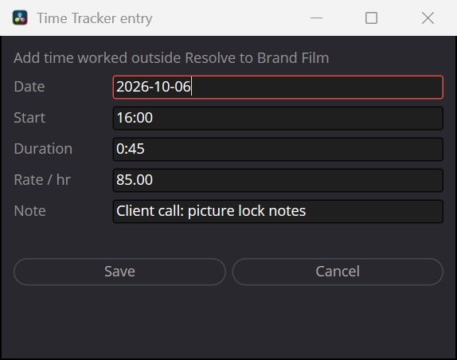
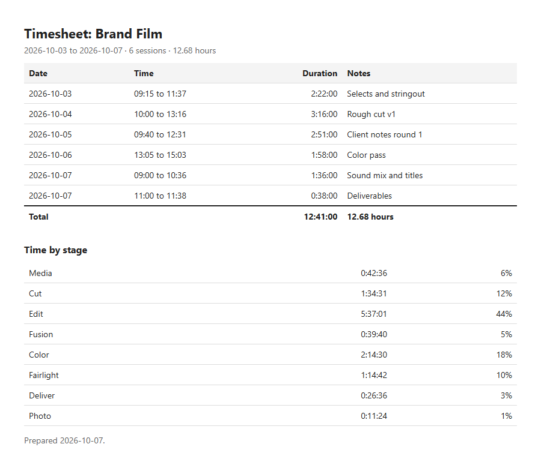

# Time Tracker for DaVinci Resolve

A free, open-source time tracker that lives inside DaVinci Resolve's
**Workspace > Scripts** menu. One Lua file: no plugins, no Python, no accounts,
nothing to sign up for. Your data stays on your computer.

It knows which project is open, which page you're working on, and when you've
walked away from the keyboard, so your timesheet reflects real work instead of a
guess. For flat-fee jobs it tells you how much time you have left before the job
stops paying your rate. When the job is done, one click gives you an
invoice-ready spreadsheet or a clean timesheet for the client.

<p align="center">
  
  &nbsp;&nbsp;
  
</p>

## What's new in 1.1

- **Flat-fee projects** with a live time budget and your effective hourly rate.
- **Client timesheet**: hours and notes without your rates, ready to print to PDF.
- **Add and edit entries**: log a client call, fix a session you forgot to stop.
- **Count renders** and **pause while Resolve is in the background** (options).
- **Opens with Resolve** on Windows, and each project remembers its own rate.
- Fixed: closing Resolve with the tracker open could leave Resolve running
  without a window, which stopped it from opening again.

## Features

- **Automatic project tracking.** Picks up the open project and keeps separate
  totals per project. Switching projects mid-session splits the session.
- **Time per page.** Bars show how your time splits across Media, Cut, Edit,
  Fusion, Color, Fairlight, Deliver and Photo. Useful for quoting the next job.
- **Idle detection with rewind.** Watches real mouse and keyboard input. If you
  step away longer than your idle limit (default 10 minutes), the session is
  closed at your *last real input*, so coffee breaks never land on the invoice.
  Tracking resumes on its own when you're back.
- **Flat-fee projects.** Enter a fixed price for the project and the tracker
  turns your hourly rate into a target: it shows how much time is left before
  the fee stops paying that rate (green, amber from 80%, red when over) and what
  you are actually earning per hour so far. Great for spotting scope creep early.
- **Rates and earnings.** Hourly rate plus currency, remembered per project, so
  switching between clients brings back each client's rate. Each session keeps
  the rate it was tracked at, so changing your rate mid-project bills every hour
  correctly. Different currencies are totalled separately, never converted.
- **Count renders (option).** Keep counting while Resolve renders, even when
  you've stepped away. Idle time only starts once the render ends.
- **Pause in background (option, Windows).** Time spent in other apps isn't
  counted; the session carries on when you switch back to Resolve.
- **Add and edit entries.** Add time you worked outside Resolve, or correct a
  session's date, time, duration, rate or note. Changes are marked in your own
  export so your records stay honest.
- **Invoice-ready CSV export.** Every project at once, grouped by project with
  each day's sessions stacked underneath, a subtotal per project and a grand
  total. Per-page time columns at every level.
- **Client timesheet.** One project's dates, times, durations and notes, with a
  time-by-stage summary and no rates or money, as a printable page and a CSV.
- **Opens with Resolve (optional, Windows).** The tracker can pop up by itself
  whenever you open a project. Tick **Start when opened** too and there's
  nothing left to remember.
- **Crash-safe.** The running session is saved every second and recovered if
  something stops the tracker unexpectedly.
- **Safe history.** Saves never overwrite good data with a half-written file,
  and deleting a session takes a confirming second click.
- **One window only.** Opening the script again brings the existing window to
  the front instead of starting a second tracker that would double-count.

## Installation

The tracker itself is one file, **`Time Tracker.lua`**. The optional auto-open
helper for Windows also needs `install.ps1` and the `autostart` folder, which
are in the same zip.

1. Download the zip from the
   [latest release](https://github.com/visavv/resolve-time-tracker/releases/latest)
   (or click **Code > Download ZIP** on this page) and extract it.
2. Install it with **one** of the options below.
3. Restart DaVinci Resolve.
4. Open it from **Workspace > Scripts > Time Tracker**.

### Windows, option A: installer script

Right-click **`install.ps1`** and choose **Run with PowerShell**. It copies the
script into your Resolve scripts folder and asks whether the tracker should open
automatically with Resolve (see [Open it automatically](#open-it-automatically-with-resolve-windows)).

If Windows says running scripts is disabled, open PowerShell in the extracted
folder and run:

```powershell
powershell -ExecutionPolicy Bypass -File .\install.ps1
```

### Windows, option B: drag and drop

1. Press **Win + R**, paste the path below and press **Enter**:

   ```
   %APPDATA%\Blackmagic Design\DaVinci Resolve\Support\Fusion\Scripts
   ```

2. If there is no **`Utility`** folder inside, create one (right-click >
   **New > Folder**, name it `Utility`).
3. Drag **`Time Tracker.lua`** into the `Utility` folder.

### macOS: drag and drop

1. In Finder, choose **Go > Go to Folder...** (Shift + Cmd + G), paste the path
   below and press **Return**:

   ```
   ~/Library/Application Support/Blackmagic Design/DaVinci Resolve/Fusion/Scripts
   ```

2. If there is no **`Utility`** folder inside, create one (**File > New
   Folder**, name it `Utility`).
3. Drag **`Time Tracker.lua`** into the `Utility` folder.

### Linux

Copy the file into your user scripts folder:

```bash
mkdir -p ~/.local/share/DaVinciResolve/Fusion/Scripts/Utility
cp "Time Tracker.lua" ~/.local/share/DaVinciResolve/Fusion/Scripts/Utility/
```

### Install for every user on the computer (optional)

Use the shared folder instead of your personal one:

| OS | Folder |
|---|---|
| Windows | `%PROGRAMDATA%\Blackmagic Design\DaVinci Resolve\Fusion\Scripts\Utility` |
| macOS | `/Library/Application Support/Blackmagic Design/DaVinci Resolve/Fusion/Scripts/Utility` |
| Linux | `/opt/resolve/Fusion/Scripts/Utility` |

### Open it automatically with Resolve (Windows)

Resolve has no setting to run a script at startup, so the installer can add a
tiny helper to your Windows Startup folder. It waits in the background and, as
soon as Resolve opens a project, opens the tracker exactly as the Scripts menu
would. If you close the tracker, it stays closed until you restart Resolve.

```powershell
powershell -ExecutionPolicy Bypass -File .\install.ps1 -Autostart
```

Turn it off again with `-RemoveAutostart` (the tracker itself stays installed).

It needs **DaVinci Resolve Studio** with **Preferences > System > General >
External scripting using** set to **Local**. Be aware that this Resolve setting
lets any program running on your computer control Resolve through its scripting
API (never other computers; that would be the *Network* option). Leave it off if
you don't want that; the tracker still works from the Scripts menu without it.
If the tracker doesn't appear, the helper's log at
`%LOCALAPPDATA%\ResolveTimeTracker\autostart.log` says why. The helper shows up
as *Time Tracker for DaVinci Resolve* in Task Manager's Startup apps.

To have tracking start the moment the window appears, also tick **Start when
opened** in the tracker.

### Updating and uninstalling

- **Update:** close the tracker window, replace `Time Tracker.lua` (or rerun
  `install.ps1`), then reopen it. Your tracked time and settings are kept.
- **Uninstall:** run `install.ps1 -RemoveAutostart` if you turned auto-open on,
  then delete `Time Tracker.lua` from the `Utility` folder. Your tracked time
  stays in the data folder (see below) until you delete that too.

## Using it

1. Open a project, then **Workspace > Scripts > Time Tracker**.
2. Set your hourly rate and currency (remembered per project) and the idle
   limit. Hover any field or option for an explanation.
3. Press **Start** (blue). The button turns red while tracking; press **Stop**
   when you're done. Add an optional note first and it's saved with the session.
4. Leave the window open while you work. It can sit behind Resolve; opening the
   script again brings it back to the front.

Set **Idle stop** to `0` to turn idle detection off.

### Flat-fee jobs

Type the agreed price into **Flat fee**. The overview then shows the fee and
your effective hourly rate (fee divided by the hours worked so far), and
**Time budget** shows how much time is left before the job drops below your
hourly rate. Clear the field to bill the project hourly again.

### Adding and correcting time

Press **Add** to log time you worked outside Resolve, such as a client call or
a review session. Select a session and press **Edit** to change its date, start,
duration, rate or note, or **Delete** (twice) to remove it.

<p align="center">
  
</p>

### Exports

- **Export CSV**: all projects with rates and earnings, for your own records
  and invoicing. Edited and manually added sessions are marked in the notes.
- **Client Timesheet**: the open project's sessions, hours and notes, without
  rates or money. It opens in your browser; print it and choose *Save as PDF*.
  A matching CSV is saved next to it.
- **Open Folder** shows where the files are.

<p align="center">
  
</p>

### What the CSV export looks like

```text
Project,Date,Start,End,Duration,Hours,Rate,Currency,Earnings,Note,Media Time,Cut Time,Edit Time,...
Brand Film,2026-09-28,09:15,11:37,2:22:00,2.3667,85.00,€,,Selects and stringout,0:42:36,1:11:00,0:28:24,...
Brand Film,2026-09-29,10:00,13:16,3:16:00,3.2667,85.00,€,,Rough cut v1,,0:23:31,2:36:49,...
Brand Film (subtotal),,,,12:41:00,12.6833,,€,1500.00,Flat fee. Effective rate € 118.27 / hr,0:42:36,...

Podcast Ep. 42,2026-09-29,15:30,16:34,1:04:00,1.0667,70.00,€,74.67,Multicam sync,0:12:48,,0:44:48,...
Podcast Ep. 42 (subtotal),,,,1:51:00,1.8500,,€,129.50,,0:12:48,,0:44:48,...

TOTAL (all projects),,,,14:32:00,14.5333,,€,1629.50,,0:55:24,1:34:31,6:21:49,...
```

Here Brand Film is a flat-fee project (its sessions have no earnings of their
own; the subtotal carries the fee) and Podcast Ep. 42 is billed hourly.

The file is comma-separated UTF-8. If your Excel uses a semicolon list
separator (common in Europe) and shows everything in one column, use
**Data > From Text/CSV** instead of double-clicking the file.

## Your data

Everything is stored locally in a hidden folder in your home directory,
`~/.resolve_time_tracker/` (on Windows `C:\Users\<you>\.resolve_time_tracker`).
**Open Folder** takes you there.

| File | Purpose |
|---|---|
| `settings.lua` | rate, currency, idle limit, options; per project: rate, currency, flat fee |
| `sessions.lua` | all completed sessions |
| `live.lua` | the running session, rewritten every second (crash recovery) |
| `instance.lock` | heartbeat of the open window (single-instance check) |
| `*.lua.bak` | previous version of each file, kept during saves |
| `Time_Tracker_*.csv` | full exports |
| `Timesheet_*.html`, `Timesheet_*.csv` | client timesheets |

To back up or move your history, copy the whole folder. If a save ever fails
(for example a full disk), the tracker keeps the session, tells you which file
failed, and retries every second.

## Good to know

- The tracker counts time while its window is open. With auto-open and
  **Start when opened** on, opening a project is all it takes.
- Quitting Resolve while tracking is fine: the session is saved as Resolve
  closes. If something stops the tracker unexpectedly instead (a crash, power
  loss, a file locked during the save), the session is recovered the next time
  the tracker opens and marked `(recovered after an unexpected stop)`.
- Idle detection reads system-wide input through Resolve's built-in LuaJIT
  (`GetLastInputInfo` on Windows, `CGEventSourceSecondsSinceLastEventType` on
  macOS). Without it the tracker still works; it just won't stop on its own.
- Projects are grouped by name. Two projects with the same name share a total,
  and renaming a project starts a new group.
- Time comes from the system clock. Manually changing the clock while tracking
  can't be corrected after the fact.

## Compatibility

The tracker is one Lua script that uses Resolve's own scripting API, so the
same file runs on every platform Resolve supports. A few extras rely on
operating-system features:

| | Windows | macOS | Linux |
|---|---|---|---|
| Tracking, pages, rates, flat fees, editing, exports | Yes | Yes | Yes |
| Idle stop with rewind | Yes | Yes | Not yet |
| Pause in background | Yes | Not yet | Not yet |
| Open automatically with Resolve | Yes (Studio) | Not yet | Not yet |

How it's verified: on Windows, every feature has been run in DaVinci Resolve
Studio 21. The automated test suite runs every test three times, as Windows,
macOS and Linux, simulating each platform's file paths, home folder and native
idle APIs. macOS and Linux have not yet been run on a real machine, and neither
has the free version of Resolve. If you use it there, please open an issue and
say how it went.

## Development

The tests run through Resolve's bundled script interpreter, `fuscript`
(Windows: `C:\Program Files\Blackmagic Design\DaVinci Resolve\fuscript.exe`).

- `test/regression_test.lua` runs the complete script against a fake UI, clock,
  idle API and in-memory disk, once per platform (Windows, macOS, Linux). It
  doesn't need Resolve running and never touches real data:

  ```
  fuscript -l lua test/regression_test.lua
  ```

These integration checks need Resolve running with a project open:

- `test/api_test.lua`: Resolve connection, page polling and idle detection.
- `test/timer_test.lua`: the UI timer event binding.
- `TT_AUTOTEST=1` runs a real ~6 second session, exports a CSV and exits.
- `TT_EXPORT_TEST=1` builds the window, exports the sessions on disk and exits.

Both self-tests require `TT_DATA_DIR` pointing at a disposable folder and
refuse to run without it, so they can't touch your real history. To try the
real window on test data, start Resolve with `TT_DATA_DIR` set in its
environment; a separate script can drive it through
`UIManager:FindWindow('ttwin'):GetItems()`.

Release zip: build it with `tar -a -c -f <name>.zip` (Windows PowerShell 5.1's
`Compress-Archive` writes backslash paths that break unzip on macOS) and include
`Time Tracker.lua`, `install.ps1`, `autostart/`, `README.md` and `LICENSE`.
Upload it as a zip: GitHub renames spaces in individual asset names.

Things worth knowing if you hack on it:

- UI timer events arrive on `disp.On.Timeout` with `ev.who` naming the timer,
  not on `disp.On.<TimerID>.Timeout` like other widgets.
- `GetCurrentPage()` returns nothing while the Project Manager is open; that
  time is recorded under `unknown`.
- Qt ignores close requests to a script window while a modal Resolve dialog
  (such as Software Update) is open.
- When Resolve quits it closes every script window. Never call into the window
  after that (`Hide()`, redraws): Resolve then abandons the quit and lingers
  without a window, which blocks reopening it. A script window also needs a
  `Close` handler that exits its loop, or Resolve waits for it forever. Other
  windows of the same script are torn down without a `Close` event.
- Hidden widgets keep their space in Fusion layouts (`Visible = false` does not
  collapse a row), so design rows that are always shown.
- Menu scripts run in a child `fuscript -q -l Lua -a <port>` process.
  `Fusion:RunScript(path)` from an external client launches a script the same
  way; the auto-open helper relies on that.
- Force-killing an external `fuscript` process can leave Resolve's external
  scripting server stuck until Resolve restarts. The Workspace > Scripts menu
  is unaffected.

## Credits

Inspired by Jamie Fenn's Time Tracker for Resolve and Chronicler by Knights of
the Editing Table for Adobe apps. This project shares no code with either.

Not affiliated with or endorsed by Blackmagic Design. DaVinci Resolve is a
trademark of Blackmagic Design Pty. Ltd.

## License

[MIT](LICENSE)
